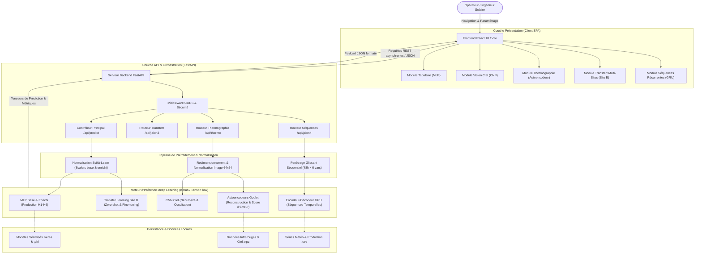
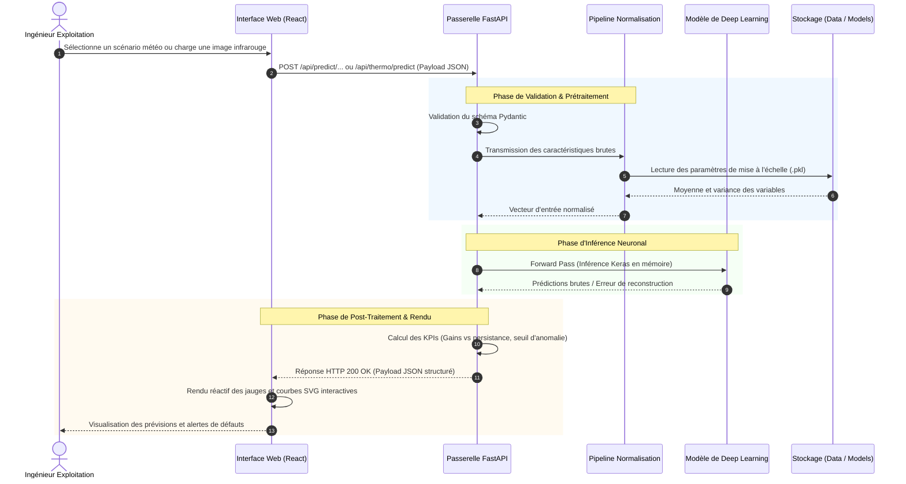

# Architecture du Système — SolarDrâa

> Ce document décrit l'architecture technique, les choix de conception, les flux de données et l'organisation modulaire de la plateforme **SolarDrâa**.

---

## 1. Vue d'ensemble (High-Level Design)

La plateforme **SolarDrâa** repose sur une architecture découplée **Client-Serveur Asynchrone** enrichie d'un moteur d'inférence d'Intelligence Artificielle multi-modale (réseaux denses, vision par ordinateur, détection d'anomalies non supervisée et réseaux récurrents).

L'application résout la complexité de l'intermittence photovoltaïque et de la maintenance de parcs industriels (50 MWc à Ouarzazate, 20 MWc à Tarfaya) grâce à 4 couches coordonnées :
1. **Couche Présentation (Frontend SPA) :** Interface interactive React 18 construite en Bento Grid, offrant des graphiques SVG vectoriels temps réel, des curseurs de sensibilité et un retour d'inférence sans latence perçue.
2. **Couche Services & API Gateway (Backend FastAPI) :** Moteur asynchrone Python orchestrant les requêtes, validant strictement les charges utiles via Pydantic v2 et exposant les endpoints REST.
3. **Moteur d'Inférence Deep Learning (TensorFlow / Keras 3) :** Ensemble de modèles spécialisés pré-chargés en mémoire vive pour des latences d'inférence inférieures à 30 ms.
4. **Couche Données & Vecteurs :** Séries chronologiques, tenseurs d'images hémisphériques du ciel et matrices thermographiques de panneaux.

---

## 2. Diagramme d'Architecture Globale

Le schéma ci-dessous détaille les interactions entre l'opérateur, l'interface web, les contrôleurs d'API et les différents moteurs d'apprentissage profond :

---

## 3. Composants Principaux

| Composant | Technologie | Périmètre & Responsabilités |
| :--- | :--- | :--- |
| **Interface Utilisateur (SPA)** | `React 18`, `Vite 5`, `Tailwind CSS` | Rendu des tableaux de bord, gestion d'état locale, micro-animations, génération des courbes SVG de production et graphiques comparatifs. |
| **Passerelle d'API REST** | `FastAPI`, `Uvicorn`, `Pydantic v2` | Réception asynchrone des requêtes HTTP, validation stricte des formats d'entrée, gestion des codes d'erreur et documentation OpenAPI automatique. |
| **Moteur MLP Tabulaire** | `Keras 3`, `Scikit-Learn` | Calcul des prévisions de puissance électrique brute sur 6 horizons temporels ($t+1h$ à $t+6h$) à partir de 47 à 51 variables météo et temporelles. |
| **Moteur Vision par Ordinateur** | `CNN Convolutif Keras` | Extraction de caractéristiques spatiales à partir des caméras fisheye du ciel pour estimer la couverture nuageuse et la trajectoire des nuages. |
| **Moteur d'Inspection Thermique** | `Autoencodeur Convolutif` | Compression dans un goulot d'étranglement latent (16 ou 32 dimensions) et reconstruction d'images infrarouges de cellules photovoltaïques pour isoler les anomalies par erreur quadratique moyenne (MSE). |
| **Moteur Transfert de Domaine** | `Transfer Learning & Fine-Tuning` | Réutilisation des connaissances acquises sur le Site A (50 MWc) pour prédire la production du Site B (20 MWc) sans données ou avec un historique réduit. |
| **Moteur Séquentiel GRU** | `Gated Recurrent Units (GRU)` | Capture de la dynamique temporelle, de l'inertie thermique des panneaux et des dérives d'encrassement sur des fenêtres historiques de 24h à 168h. |

---

## 4. Flux de données (Data Workflow)

Le diagramme de séquence ci-après détaille le cycle complet d'une demande de prévision ou d'analyse thermographique initiée depuis l'interface :

---

## 5. Persistance, Modèle de Données & Modèles IA

La plateforme stocke et manipule trois catégories d'actifs :

### 1. Séries Temporelles & Données Tabulaires (`data/*.csv` & `data/jalon3_results/`)
- **`uc4_siteA.csv` :** 26 304 observations horaires (3 années complètes) issues de la centrale d'Ouarzazate (50 MWc) comprenant :
  - Variables solaires calculées : Hauteur du soleil, azimut, zénith, $GHI_{ciel\_clair}$.
  - Variables météorologiques mesurées et prévues : $GHI$, température ambiante, nébulosité prévue.
  - Exploitation : Jours écoulés depuis le dernier nettoyage des panneaux et production réelle en MW.
- **`uc4_siteB.csv` :** Données chronologiques de la centrale côtière de Tarfaya (20 MWc) soumise à des régimes d'humidité et brouillards distincts.
- **`data/jalon3_results/` :** Bilans de validation, matrices d'erreurs par horizon et comparatifs des stratégies de transfert ($A \rightarrow B$).

### 2. Tenseurs Matriciels Compressés (`data/*.npz`)
- **`uc4_ciel_A.npz` & `uc4_ciel_B.npz` :** Échantillons d'images plein ciel associant les labels de couverture nuageuse et les timestamps.
- **`uc4_thermographie.npz` :** Végétation d'images infrarouges de modules solaires au format $64 \times 64$ pixels étiquetées selon 5 classes de référence (sain, fissure, déconnexion, point chaud, salissure).

### 3. Poids de Réseaux de Neurones (`models/*.keras` & `*.pkl`, `*.joblib`)
- **`mlp_base.keras` & `mlp_enrichi.keras` :** Réseaux entièrement connectés avec régularisation Dropout (0.2) et activation ReLU.
- **`modele_ciel.keras` & `cnn_mouvement.keras` :** Réseaux convolutifs avec couches Conv2D, MaxPooling et BatchNorm.
- **`ajout_j3_transfert.keras` & `j3_cnn_B_simple.keras` :** Réseaux affinés pour l'adaptation de domaine vers le Site B (Tarfaya).
- **`autoencodeur_goulot_16.keras` :** Encodeur convolutif réduisant l'image en un vecteur de 16 flottants avant décodage miroir.
- **`encdec_gru.keras` :** Réseau récurrent Sequence-to-Sequence (cellules GRU) adapté aux horizons de prévision glissants.
- **`scaler_base.pkl`, `scaler_enrichi.pkl` & `ajout_j1_scaler.joblib` :** Objets de normalisation Scikit-Learn calibrés.

---

## 6. Sécurité, Réseau & Déploiement

- **CORS (Cross-Origin Resource Sharing) :** Le backend intègre `CORSMiddleware` configuré pour autoriser les requêtes provenant du frontend local (`http://localhost:5173`) et des domaines dynamiques Cloudflare Tunnel.
- **Isolation du Processus d'Inférence :** L'inférence est exécutée localement en CPU ou Edge avec un thread-pool asynchrone non bloquant pour le serveur web FastAPI.
- **Tunneling Cloudflare Edge :** Le script d'exécution instancie un tunnel Cloudflare éphémère (`trycloudflare.com`) permettant de présenter l'application en conditions réelles sans ouverture de port entrant sur le routeur ni exposition d'adresse IP publique.
- **Gestion des Signaux Système :** Les scripts `start.sh` et `stop.sh` capturent les signaux `SIGINT` et `SIGTERM` pour garantir l'arrêt propre des processus enfants (PID de FastAPI, Vite et Cloudflare Tunnel).

---

[⬅ Retour au README principal](../README.md)
